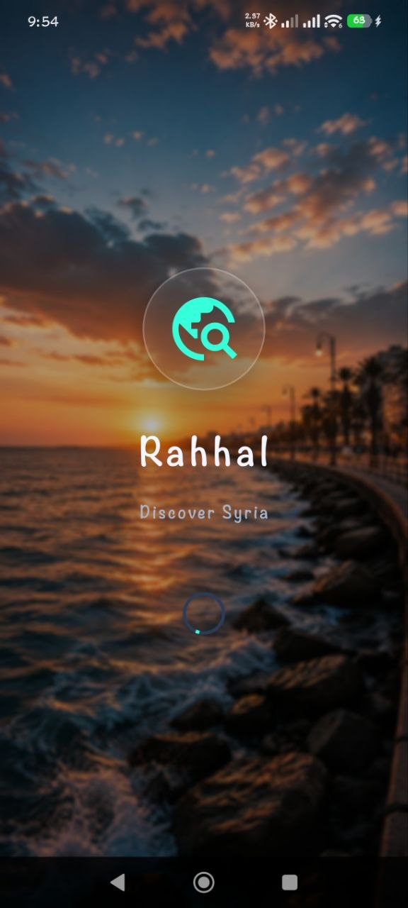
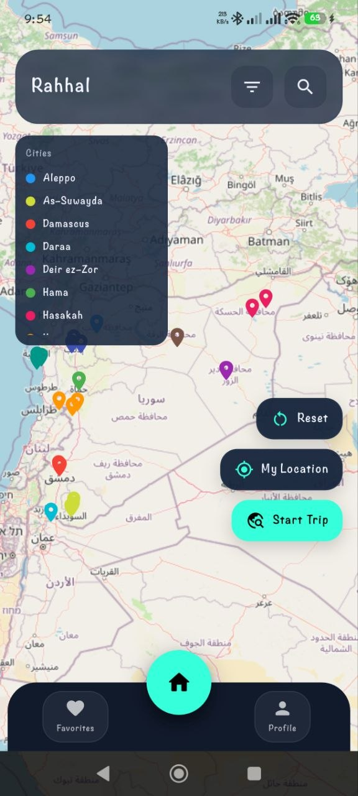
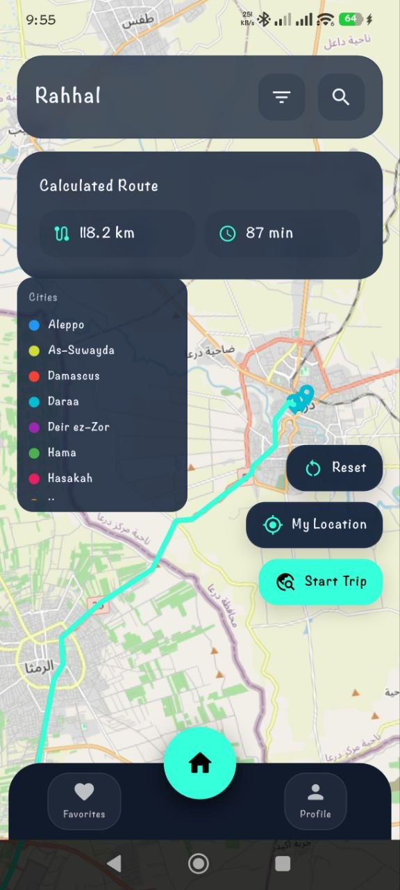
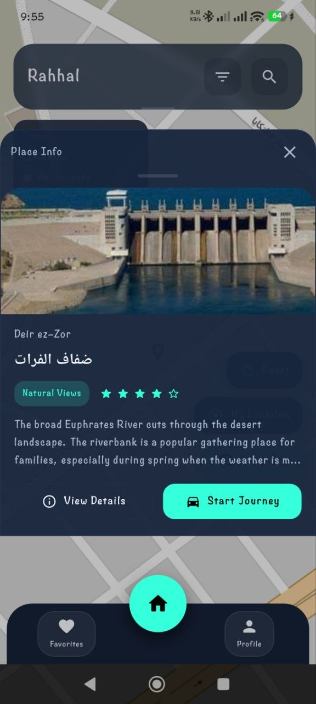

# تطبيق دليل السياحة في سوريا

تطبيق Flutter يوفر دليلاً سياحياً شاملاً للمدن السورية مع إمكانية عرض المواقع على الخرائط ومسارات الرحلات.

## لقطات الشاشة

### شاشة البداية



### الخريطة



### المسار على الخريطة



### تفاصيل المكان



### بدء الرحلة


## التقنيات المستخدمة

- **Flutter**: إطار العمل الرئيسي لبناء التطبيق
- **flutter_bloc**: إدارة الحالة بنمط Cubit
- **go_router**: نظام التوجيه والتنقل بين الصفحات
- **get_it**: حقن التبعيات
- **flutter_map**: عرض الخرائط التفاعلية
- **location**: تحديد الموقع الجغرافي
- **http**: إجراء طلبات الشبكة
- **shared_preferences**: حفظ البيانات المحلية
- **latlong2**: التعامل مع الإحداثيات الجغرافية

## Architecture Overview

```
lib/
├── bootstrap/          # App initialization
├── core/               # Shared utilities and infrastructure
│   ├── adaptive/       # Platform-specific utilities
│   ├── constants/      # App-wide constants (colors, spacing, typography)
│   ├── di/             # Dependency injection (GetIt)
│   ├── error/          # Error/failure abstractions
│   ├── extensions/     # Dart extensions
│   ├── responsive/     # Responsive design utilities
│   ├── router/         # GoRouter configuration
│   ├── services/       # Core services
│   ├── theme/          # Theme configuration
│   └── widgets/        # Reusable UI components
├── presentation/       # Feature modules
│   ├── home/
│   ├── navigation/
│   └── splash/
└── main.dart
```

## State Management

**Cubit** (from flutter_bloc) for reactive state management.

- Cubits are lazy-loaded per screen
- No global cubits at app root
- Clean lifecycle: created on screen build, disposed on pop

## Routing

**GoRouter** with centralized route definitions.

- Route paths in `core/router/route_paths.dart`
- Route names in `core/router/route_names.dart`
- StatefulShellRoute for bottom navigation

## Dependency Injection

**GetIt** for service location.

- Singleton services registered in `core/di/injector.dart`
- Accessed via `getIt<ServiceType>()` throughout the app

## Theme System

Centralized design tokens:

- **Colors**: `core/constants/app_colors.dart`
- **Typography**: `core/constants/app_text_styles.dart`
- **Spacing**: `core/constants/app_spacing.dart`

## Getting Started

```bash
# Install dependencies
flutter pub get

# Run the app
flutter run

# Analyze code
flutter analyze

# Run tests
flutter test
```

## Adding a New Feature

1. Create feature folder under `lib/presentation/`
2. Add cubit for state management
3. Add screens and widgets
4. Register routes in `core/router/app_router.dart`

## Core Guidelines

- **DO NOT** add business logic to Core folders
- **DO NOT** create cross-feature dependencies
- **DO** keep features self-contained
- **DO** use centralized constants for design tokens
- **DO** use existing core widgets when possible

## Git Workflow

### Branch Naming

```
feature/feature-name
fix/bug-description
chore/task-description
```

### Commit Messages

```
feat: add new feature
fix: resolve bug
chore: update dependencies
refactor: restructure code
docs: update documentation
```

### Pull Request Guidelines

- Keep PRs focused and small
- Include description of changes
- Ensure `flutter analyze` passes
- Request review before merging
